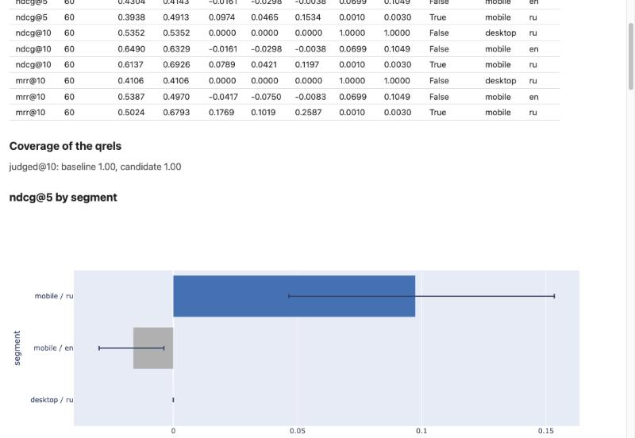

# ranklens

[](https://github.com/AlexandrBaranov7/ranklens/actions/workflows/ci.yml)
[](https://alexandrbaranov7.github.io/ranklens/)

Модель поменяли — стало ли лучше, **где** и **почему**? ranklens отвечает на это из
таблиц pandas одной строкой: разница с интервалом, p- и q-value, минимальный заметный
эффект (MDE), разбивка по сегментам с поправкой на множественные сравнения. Метрики
совпадают с trec_eval до 1e-9.

```python
import ranklens as rl

rl.compare(current, new, qrels, ["ndcg@10"], by="device")
```

## Что пригодилось на рабочих задачах

Перед релизом библиотеку прогнали как пользователь на двух задачах из продакшна.
Три вещи оказались самыми полезными — с них и стоит начинать.

**1. Эффект, невидимый в среднем: сегменты, сиды и MDE.** В каталожную модель добавили
признак «товар в избранном у пользователя».

```python
# по два сида обучения у каждой модели: усредняются по запросу до статистики
rl.compare([base_s0, base_s1], [flag_s0, flag_s1], qrels, ["ndcg@10"], by="has_flag")
```

В среднем NDCG@10 +0.0004 при MDE 0.0003 — на пределе чувствительности, такое легко
списать на шум. По сегментам: на 2.8% запросов, где у пользователя есть избранное,
+0.0147 [+0.0117; +0.0177], на остальных — без потерь. Решение — выкатывать.

**2. Две выдачи размечены разными партиями асессоров.** Сравнивали текущую выдачу
витрины с новой (другой кандидатогенератор, а значит и другое ранжирование); каждую
размечала своя партия краудсорсинга.

```python
rl.agreement(batch_cur, batch_new)  # 75% совпадений, вторая партия мягче на 0.05 балла
qrels = rl.merge_qrels(batch_cur, batch_new)  # одна разметка для обеих сторон
rl.compare(current, new, qrels, ["ndcg@5", "ndcg@10", "err@10"])
```

На «своих» оценках разница партий смешалась бы с разницей систем. На общей разметке
NDCG@10 значимо выше (q = 0.034), а NDCG@5 и ERR@10 — нет: новые кандидаты делают
выдачу полнее и улучшают позиции 5–10, а первые карточки не изменились.

**3. Почему: вклад признаков прямо в метрику.**

```python
ex = rl.explainer(model, features, query="qid", doc="sku", relevance="relevance")
ex.importance("ndcg@10")  # насколько падает метрика, если перемешать признак
ex.worst(20)  # худшие запросы и признаки, которые их подвели
```

Новый признак оказался первым по вкладу в NDCG@10 на запросах, где он есть.

## Установка

```bash
pip install "ranklens[viz] @ git+https://github.com/AlexandrBaranov7/ranklens"
```

Версия 0.1.0 есть на TestPyPI: `pip install -i https://test.pypi.org/simple/
--extra-index-url https://pypi.org/simple/ ranklens`. Extras: `viz` (графики
и HTML-отчёты), `arrow` (parquet, Feather), `models` (CatBoost, LightGBM, XGBoost,
scikit-learn), `neural` (ONNX). PyTorch ставится по инструкции pytorch.org.

## Данные и командная строка

`rl.run` и `rl.qrels` берут таблицу pandas, polars или pyarrow с одной строкой на пару
«запрос — документ»; порядок — по скору модели (`score=`), по позиции (`rank=`) или
порядку строк. Несколько выдач на запрос (по магазинам, сессиям) — `list_id=`.

```python
qrels = rl.qrels(labels, query="qid", doc="sku", relevance="grade")
current = rl.run(df_a, query="qid", doc="sku", rank="pos", segments="device")
new = rl.run(df_b, query="qid", doc="sku", rank="pos", segments="device")
```

Те же сравнения из терминала — для файлов и CI:

```bash
ranklens eval --run run.trec --qrels qrels.trec --metrics ndcg@10 mrr@10
ranklens compare --baseline a.csv --candidate b.csv --qrels qrels.csv \
    --metrics ndcg@10 mrr@10 --segments device locale --report compare.html
ranklens explain --model model.cbm --features features.csv --top-worst 20
```

```text
metric   device   locale  queries  mean A  mean B  delta    95% CI              p       q
ndcg@10  desktop  ru      60       0.5352  0.5352  +0.0000  [+0.0000, +0.0000]  1.0000  1.0000
ndcg@10  mobile   en      60       0.6490  0.6329  -0.0161  [-0.0302, -0.0038]  0.0655  0.0982
ndcg@10  mobile   ru      60       0.6137  0.6926  +0.0789  [+0.0409, +0.1234]  0.0005  0.0015  *
```

`--report compare.html` пишет один файл со всеми графиками, который открывается без
интернета: таблица, покрытие разметкой, разница по сегментам с интервалами (значимые
после поправки — синим), распределение поразапросных разниц, метрика по cutoff,
перемещения документов из топ-10.



Подробнее — [«Первые шаги»](https://alexandrbaranov7.github.io/ranklens/tutorial/).

| Что | Где |
|---|---|
| Таблицы pandas/polars → сравнение одной строкой: сиды, сегменты, MDE, покрытие разметки | `import ranklens as rl` |
| NDCG, MAP, MRR (умолчания trec_eval), ERR, RBP, RBO, judged@k; свои метрики — плагином | `ranklens.metrics` |
| Парный bootstrap по запросам, перестановочный тест, Бенджамини — Хохберг, MDE | `ranklens.stats` |
| Сравнение по сегментам с q-values | `ranklens.aggregate` |
| Неточная разметка: согласие партий, общая разметка, PPI++ (дешёвая proxy-разметка + gold-выборка), judged@k | `rl.agreement`, `rl.merge_qrels`, `ranklens.stats` |
| Off-policy: IPS и SNIPS по логам кликов, PBM, симулятор с известной истиной, ESS | `ranklens.offpolicy` |
| Объяснение: Шепли для пары документов, вклад признаков в метрику, группы коррелированных признаков, худшие запросы | `rl.explainer`, `ranklens.explain` |
| Графики и самодостаточные HTML/Markdown-отчёты | `ranklens.viz`, `ranklens.report` |

## Почему не существующие библиотеки

- **[pytrec_eval](https://github.com/cvangysel/pytrec_eval)** — обёртка над trec_eval:
  быстрый эталон метрик, десятки мер. ranklens сверяется с ним golden-тестами и
  проигрывает ему в числе мер. Но pytrec_eval отвечает на «сколько», а не на «отличимо
  ли это от шума» — сравнения, интервалов и сегментов в нём нет.
- **[ir_measures](https://github.com/terrierteam/ir_measures)** — единый интерфейс
  к нескольким реализациям мер; хорош, когда нужна именно мера из конкретного инструмента.
  Статистику сравнения и объяснения он не делает.
- **[ranx](https://github.com/AmenRa/ranx)** умеет и метрики, и статистическое
  сравнение прогонов, и fusion — ближайший аналог в части сравнения. ranklens добавляет
  то, чего в нём нет: поправку FDR по сегментам, MDE, PPI для неточной разметки,
  off-policy оценку по кликам и объяснение модели по метрике.

ranklens не заменяет их в скорости и полноте набора мер — он закрывает путь от
«цифра изменилась» до «вот где и почему».

## Архитектура

Слои с проверяемыми границами: `core` (типы, результаты, протоколы, исключения — только
stdlib) → `io`, `metrics`, `stats`, `viz` → `aggregate`, `offpolicy`, `explain`, `report`
→ `api` (`import ranklens as rl`) и `cli`. `tests/test_architecture.py` разбирает AST каждого модуля и падает, если слой
импортирует то, что ему не положено, или тяжёлую библиотеку не лениво. Прогоны читаются
потоком (генератор, в памяти — одна выдача), разметка — в словарь для поиска за O(1).
Подробно — [«Устройство»](https://alexandrbaranov7.github.io/ranklens/design/).

## Выбор структур данных и средств языка

| Требование | Где | Почему так |
|---|---|---|
| `list` | буфер строк текущего запроса в `iter_run`, `iter_clicklog` | дописывание в конец — амортизированное O(1); собранная выдача сразу становится `tuple` |
| `tuple` | `RankedList.docs`, `SegmentKey`, `Impression.positions`, вклады признаков | порядок — это позиция; неизменяем и хешируем: поле frozen-объекта и ключ словаря. `list` в frozen dataclass менялся бы на месте |
| `dict` | `Qrels: dict[QueryId, dict[DocId, float]]`, реестр метрик, `ADAPTERS` | поиск оценки пары запрос–документ за O(1) в горячем цикле; реестры вместо цепочек `if` — точки расширения |
| `set` | дубликаты документов в `RankedList`, общие запросы двух прогонов, повторы в ридерах | проверка дубликатов O(n) вместо O(n²); общие запросы — ровно `a.keys() & b.keys()` |
| генератор | `iter_run`, `iter_clicklog`, `iter_records` | в памяти — строки одного запроса: на отсортированном входе память постоянна, на сгруппированном растёт на ~200 байт на запрос (id уже прочитанных); тесты меряют пик `tracemalloc` на файле в 10 раз больше |
| свой итератор | `PairedRuns` (`__iter__`/`__next__`) | merge-join двух отсортированных потоков; `zip` молча спарил бы разные запросы, когда в одном прогоне запрос пропущен |
| своё исключение | иерархия `RankLensError`: `DataError`, `ConfigError`, `ModelError`, `StatisticalError` | у ошибок поля (`line_no`, `path`, `column`) и подсказки («did you mean 'ndcg'?»); аргументы в `super().__init__` — иначе не переживают pickle (тест) |
| осмысленная обработка | `ErrorCollector`: битые строки пропускаются и считаются; `--strict` останавливает | два сценария — разведка данных и CI-гейт; коды выхода 0 / 1 конфигурация / 2 аргументы / 3 данные |
| контекстный менеджер | `AtomicReport` | временный файл в той же директории, `fsync`, `os.replace` только без исключения; при ошибке или `Ctrl-C` остаётся прежний отчёт. `with open()` сначала обнулил бы цель |
| аннотации + mypy | весь пакет и тесты, mypy `strict`, `py.typed` | ошибки типов ловятся в CI до тестов; пакет отдаёт типы пользователям |
| pytest | 750+ тестов, покрытие ~99%, порог 90% | точные значения, property-based (Hypothesis), golden против trec_eval, статистическая валидация на симуляциях |
| `pyproject.toml` | PEP 621, `[project.scripts]`, entry points `ranklens.metrics`, extras | одна точка для метаданных, команды, плагинов и необязательных зависимостей |
| установка pip | задание CI `install` | собранный wheel ставится **обычным pip** в чистое окружение, и `scripts/tutorial_smoke.py` проходит «Первые шаги» вне репозитория |
| pandas + агрегация | `offpolicy/events.py`: `merge`, `groupby().max()`, `explode`, `value_counts`; `aggregate` — таблица по сегментам | склейка событий показов и реакций — табличная операция; сегменты отдаются DataFrame |

Неизменяемость результатов: `frozen=True, slots=True` + `tuple` + `MappingProxyType` +
read-only массивы numpy — `frozen` сам по себе запрещает только присваивание полей.

## Почему Protocol, а не ABC

Метрика — любой вызываемый объект `(ranked, judgements, k) -> float`, в том числе обычная
функция; модель для объяснений — любой объект с `feature_names`, `score`,
`native_importance`. Это `typing.Protocol`: структурная типизация, реализации не
наследуются от наших классов, и чужую модель или функцию не нужно встраивать в иерархию.
С ABC каждую сторонюю модель пришлось бы оборачивать в подкласс. Имя метрики хранится
в спецификации (`ndcg@10`): у функции нет атрибута `name`, и протокол с ним её бы
не принял. Новая модель — класс-адаптер и одна строка в `ADAPTERS`; адаптер находится
по MRO класса модели, поэтому подкласс `LGBMRanker` из чужого кода тоже распознаётся.

## Почему ресемплинг по запросам

Единица наблюдения — запрос. Пусть 100 запросов по 10 документов. Ресемплинг строк
считал бы, что наблюдений 1000, хотя документы одной выдачи зависимы — интервал вышел бы
примерно в √10 ≈ 3 раза уже правды. Поэтому bootstrap берёт с возвращением **запросы**
и усредняет поразапросные разницы `M_B(q) − M_A(q)`; перестановочный тест меняет знак
разницы целиком у запроса. Проверено симуляцией: 95%-й интервал покрывает истинную
разницу в 95.3% из 1000 повторов. Вывод — в
[«Статистике сравнения»](https://alexandrbaranov7.github.io/ranklens/math/statistics/).

## Ограничения

- **Вход должен быть сгруппирован по запросу** (строки запроса подряд), для `PairedRuns` —
  отсортирован; иначе ошибка, а не тихая потеря запросов. Разметка грузится в память целиком.
- **Неразмеченный документ считается нерелевантным** (как в trec_eval): прогон, который
  приносит много нового, проигрывает из-за разметки. `compare` показывает judged@k
  и предупреждает о разрыве; PPI++ лечит систематическую ошибку разметки при наличии
  случайной gold-выборки.
- **Перцентильный bootstrap-интервал** на малых выборках бывает уже нужного; поэтому
  p-value — из перестановочного теста, а меньше 20 запросов — предупреждение.
- **Off-policy:** PBM с фиксированными propensity не описывает каскадное поведение;
  неверные propensity смещают IPS; документы, которых старая модель не показывала,
  не оцениваются никакими весами. SNIPS здесь — отношение (классический SNIPS
  на PBM-веса не переносится) и оценивает долю, а не клики.
- **Объяснения:** точки «наполовину A, наполовину B» и перемешанные признаки бывают
  нереалистичными; Шепли точен до 12 признаков, дальше — по выборке порядков;
  текстовые кросс-энкодеры и LLM-реранкеры (без матрицы признаков) не объясняются
  ([#34](https://github.com/AlexandrBaranov7/ranklens/issues/34),
  [#35](https://github.com/AlexandrBaranov7/ranklens/issues/35)).
- **Модели из pickle** исполняют код при загрузке — только с `--allow-pickle`
  ([SECURITY.md](SECURITY.md)).

## Использование LLM

> Временный раздел курсового проекта, удаляется при чистке после защиты
> (CONTRIBUTING, раздел 11).

Код писался с ассистентом (Claude Code) маленькими PR, по неделям. Полный журнал —
[`docs/llm-log.md`](docs/llm-log.md): что предложил ассистент, что не устроило автора
и что переписано, что проверено. Решения с обоснованием — [`docs/decisions.md`](docs/decisions.md).

Решения, принятые автором, а не ассистентом: умолчания метрик как в trec_eval; обратная
связь — награда в ядре и упорядоченная шкала событий поверх; окно атрибуции от показа;
оба off-policy оценщика с клиппингом; нейминг proxy/gold в PPI и λ по данным; поддержка
нейросетевых ранкеров; правки по ревью (алиас `mde`, формулировка p-value «такую же
или более экстремальную»). Начиная со стека PR #29 ревью по просьбе автора выполнял
ассистент — в журнале это отмечено у каждой записи.

## Roadmap

- Doubly Robust оценщик и Regression-EM для оценки propensity по логам; каскадные
  click-модели.
- PPI в сравнении по сегментам и в CLI; стратифицированная gold-выборка.
- Объяснение текстовых реранкеров ([#34](https://github.com/AlexandrBaranov7/ranklens/issues/34)),
  смещения LLM-реранкеров ([#35](https://github.com/AlexandrBaranov7/ranklens/issues/35)),
  GPU-бэкенд метрик ([#17](https://github.com/AlexandrBaranov7/ranklens/issues/17)).

## Разработка

```bash
git clone https://github.com/AlexandrBaranov7/ranklens.git
cd ranklens
poetry install --all-extras   # Poetry >= 2.4
poetry run pytest
```

Правила — в [CONTRIBUTING.md](CONTRIBUTING.md), изменения — в [CHANGELOG.md](CHANGELOG.md).

## Лицензия

MIT
